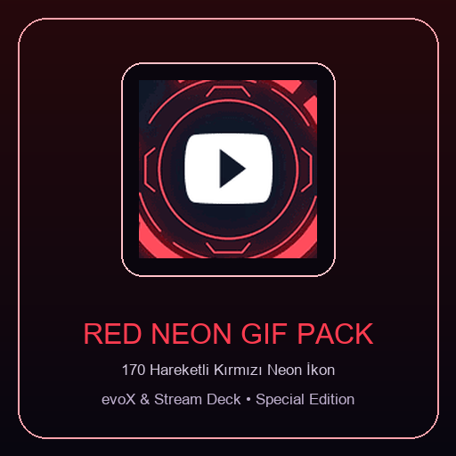

  
  <h1>Red Neon Animated GIF Pack (170 Icons)</h1>
  
<strong>170 Crimson & Red Cyberpunk Animated GIF Icons for Elgato Stream Deck & evoX.</strong>

  

    <strong>Language / Dil:</strong> <a href="README.md"><strong>English</strong></a> | <a href="README.tr.md"><strong>Türkçe</strong></a>
    &nbsp;•&nbsp;
    <a href="https://github.com/Hfatih/red-neon-gif-pack/releases/latest">Download .evoxpack</a> ·
    <a href="https://hfatih.github.io/red-neon-gif-pack/">Live Interactive Gallery</a> ·
    <a href="#installation--usage">How to Install</a>
  

  

    
    
    
    
    
    
    
  

  

    
    
    
    
    
  

---

## 🕹️ Live Interactive Web Simulator & Gallery
Explore and preview all 170 animated GIF loops on an interactive 15-key virtual Stream Deck:  
👉 **[Open Live Simulator on GitHub Pages](https://hfatih.github.io/red-neon-gif-pack/)**

- **15-Key Animated Playback:** Simultaneous animated GIF playback across all LCD keys.
- **Search & Live Filtering:** Instantly filter weapons, telemetry, skulls, visualizers, and HUDs.
- **Randomize Deck:** Test different 15-key combinations with one click.
- **Package Download:** Download `Red Neon Gif Pack.evoxpack` directly from the web interface.

---

## 📖 Overview
The **Red Neon Animated GIF Pack** brings 170 intense, glowing crimson loops to your hardware deck. Tailored for gaming, esports streaming, and high-intensity command decks, each animation has been mathematically optimized for low-overhead looping.

Features:
- **Audio & Equalizer Pulses:** Beating waveforms, frequency bars, and rhythm rings.
- **Tactical HUDs & Scopes:** Targeting reticles, radar sweeps, and cyberpunk telemetry.
- **Weapons & Combat:** Flaming blades, sci-fi weaponry, and danger emblems.
- **System Diagnostics:** Warning triangles, alert beacons, and CPU/RAM load rings.

---

## 🚀 Installation & Usage

### 1. Elgato Stream Deck
1. Drag any `.gif` from the `icons/` folder directly onto a Stream Deck key.
2. The Stream Deck software will instantly loop the animated GIF natively.

### 2. evoX Action Deck
1. Download `Red Neon Gif Pack.evoxpack` from [Releases](https://github.com/Hfatih/red-neon-gif-pack/releases/latest).
2. Double-click or import into evoX. All 170 animated icons will be added to your library.

---

## 🛠️ Technical Specifications
- **Format:** Compounded GIF with global color palette optimization
- **File Size:** ~21.2 MB total package (under evoX 50 MB compressed limit)
- **Validation:** 100% evoX Zod Schema & Stream Deck compatible
- **Resolution:** Native high-DPI squircle fitting

---

## 📄 License
Released under the [MIT License](LICENSE).
